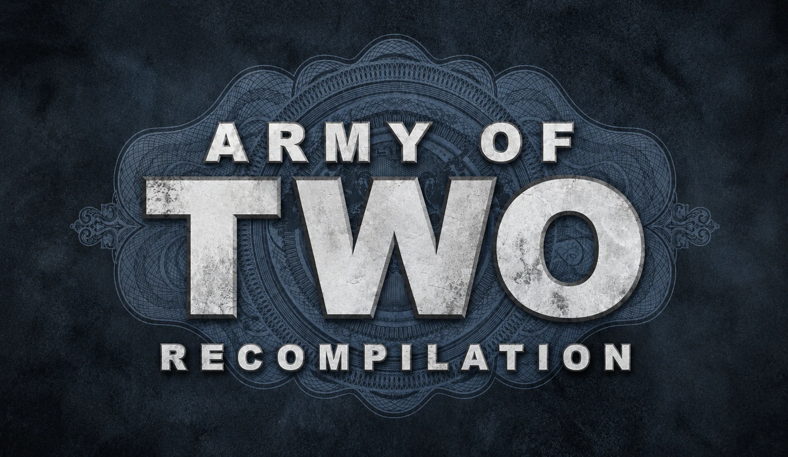

<p align="center">
  
  <br>
  
  
  
</p>

# Army of Two Recompilation

Unofficial PC port of the Xbox 360 version of Army of Two (2008). The campaign can be played in online co-op, without EA servers.
Graphics go through the port's own Direct3D 12 renderer, not GPU emulation.
The game's PowerPC code is statically recompiled
to C++ with the ReXGlue SDK and built as a Windows x64 executable.

The whole game is finishable in solo or co-op without crashes. Tested on NVIDIA GeForce RTX 2060 and RTX 4060,
stable 144 FPS.

The repository contains no game files. You need your own copy of the game.

Found a bug or have a suggestion? Please open an [issue](https://github.com/OpenPortroid/ArmyOfTwoRecompilation/issues).

## Requirements

- Windows 10/11 x64 only, a GPU with Direct3D 12
- About 6 GB of disk space, plus 1.3 GB for the DLC
- Army of Two for Xbox 360 (European release), Title Update 2 and DLC (optional)

## Installation

1. Download the package from [Releases](https://github.com/OpenPortroid/ArmyOfTwoRecompilation/releases) and extract
   it to a writable folder (not `Program Files`).
2. Run `ArmyOfTwoLauncher.exe`. If the game is not installed, it opens the install screen.
3. Choose the disc image (`.iso`) or `default.xex` of an extracted game, and the Title Update 2 package
   `TU_12K222C_0000004000000.00000000000G1`. DLC packages are optional.
4. Press Install. The files are copied to `assets\`.

Saves: `Documents\armyoftworecomp_tu2`. To update, extract the new package over the old one.

On the first runs shaders are compiled, so there are short stutters.

## What the port adds

- Online coop mode without reliance on EA servers, supporting both Public and Private Co-op
- Split-screen on one PC with each player's devices chosen in the launcher
- Graphics settings inside the game: Options → Graphics
- Key and mouse rebinding inside the game: Options → Graphics → Controls
- Render resolution above the console's 720p
- Optimized performance with stable frame rates
- Keyboard and mouse support, including keyboard key glyphs in on-screen button prompts
- Input remapping for both keyboard and gamepad, available in the launcher
- Skippable pre-rendered cutscenes using the Enter or Space key
  
## Controls

Action|Keyboard / mouse|Controller
-|-|-
Move|W A S D|Left stick
Camera / aim|Mouse|Right stick
Fire|LMB|RT
Precision aim|RMB|LT
Reload|R|X
Roll / cover / vault|Space|Y
Use / confirm|E / Enter|A
Back|Backspace / Q|B
Crouch|Ctrl / C|L3
Inventory (hold)|Z|LB
Co-op commands (hold)|F|RB
Weapons and grenades|1–4|LB + D-pad
Partner orders|Arrows|D-pad
R3|MMB|R3
GPS|Tab|Back
Pause|Esc|Start

Bindings: in the game, Options → Graphics → Controls (Enter or a click on a row, then the key; left adds
one more key); the launcher's Settings → Keyboard and Gamepad tabs (press the key or button to assign it, combinations
and mouse buttons 4–5 work), or `settings\mapping.toml` (`keybind_*`, `padbind_*`). Gamepads work as on the console.

## Co-op

- Works over LAN or a virtual network (Radmin VPN, ZeroTier, Tailscale).
- Both players start the game from the launcher. The launcher looks for a host on the local network and picks the
  role. Over the internet, enter the host's IP in the launcher's Settings → Network (or F8 in the game).
- Public Co-op: Campaign Mode → Public Co-op Game.
- Private Co-op (recommended), with invites: the lobby's Invite button opens the Players window (also F8) with the
  players found on the network; the partner accepts the invite with F6. Unlike Public Co-op, it keeps checkpoints,
  so you can continue the game later.
- Both players need the same build of the port, the same DLC and the same game language.
- Run `Allow through firewall (run as administrator).bat` once on both PCs.

Details: [aot/docs/online_coop.md](aot/docs/online_coop.md).

## Split-screen

- Two players on one PC: in the launcher, Settings → Split-Screen, turn it on, enter both gamertags and pick each
  player's devices from the list of connected ones: the keyboard and mouse, a specific gamepad, any gamepad, or the
  keyboard plus a pad. Play then starts the game at once, without the host search.
- Player 2 signs in with their own profile and saves while a device is assigned to them.
- The mouse aims and drives for the player who has the keyboard.
- Button prompts follow each player: keys in the keyboard player's half of the screen, Xbox buttons in the other's;
  a prompt they share shows both.
- Without the launcher: `input_player1`, `input_player2`, `user_gamertag_2` and `max_local_users` in
  `settings\mapping.toml`.

## Settings

TOML files in `settings\`.

File|Contents
-|-
`hardware.toml`|Window, fullscreen, render scale (`ao2_native_gpu_resolution_scale`), FPS cap (`ao2_fps_target`), anisotropic filtering, language (`ao2_game_language`)
`mapping.toml`|Key and gamepad bindings, mouse sensitivity and inversion, split-screen players and devices
`online.toml`|Co-op settings, gamertag

## Building

Needed: Visual Studio 2022 Build Tools, LLVM/Clang, CMake, Ninja, Git, and the game files with `default.xexp` from
TU2 in `aot/assets/` ([aot/assets/README.md](aot/assets/README.md)).

Folder|Contents
-|-
`aot/`|The port: manifest, sources (`aot/src`), renderer (`aot/src/gpu/native`), settings
`sdk_changes/`|Changed ReXGlue SDK files ([README](sdk_changes/README.md))
`launcher/`|Launcher ([README](launcher/README.md))
`tools/`|Debug and test tools

1. SDK with the port's changes:

   ```
   powershell -ExecutionPolicy Bypass -File sdk_changes\apply.ps1
   build-sdk.cmd
   ```

2. Code generation:

   ```
   cd aot
   rexglue\win-amd64\bin\rexglue.exe codegen armyoftworecomp_manifest.toml
   ```

3. Game build: `build.cmd` (release; other modes are listed at the top of the file). It also copies the modified
   `rexruntime.dll` from `sdk\` next to the game.

Release package: `aot\tools\make_release.ps1 [-Zip]`. Renderer notes: [aot/docs/native_renderer.md](aot/docs/native_renderer.md).

## Legal

A fan project, not affiliated with Electronic Arts. Army of Two and related names are trademarks of their owners.
The repository contains only the port's code and the recompilation config; the recompiled code is generated locally
from your copy of the game.
