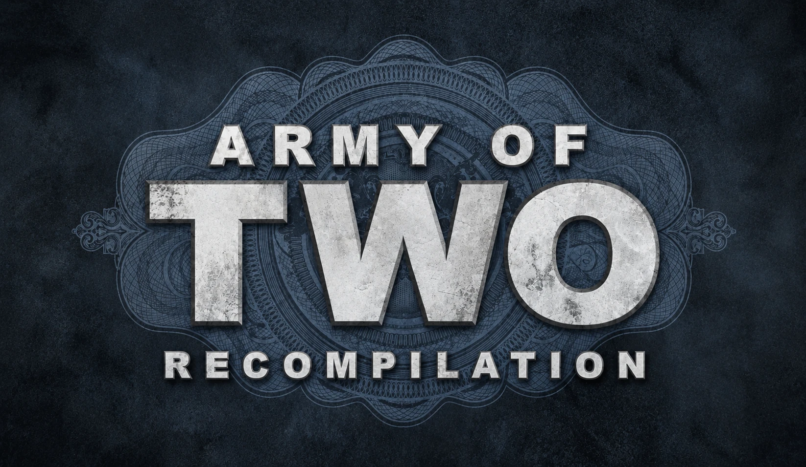

<p align="center">
  
  <br>
  
  
  
</p>

# Army of Two Recompilation

Unofficial PC port of the Xbox 360 version of Army of Two (2008). The campaign can be played in online co-op and
versus online against other players and bots, all without EA servers.
Graphics go through the port's own Direct3D 12 renderer, not GPU emulation.
The game's PowerPC code is statically recompiled
to C++ with the ReXGlue SDK and built as a Windows x64 executable.

The whole game is finishable in solo or co-op without crashes. Tested on NVIDIA GeForce RTX 2060 and RTX 4060.

The repository contains no game files. You need your own copy of the game.

Found a bug or have a suggestion? Please open an [issue](https://github.com/OpenPortroid/ArmyOfTwoRecompilation/issues).

## Requirements

- Windows 10/11 x64 only, a GPU with Direct3D 12
- A CPU with AVX2; for CPUs without it there is an AVX1 version (`avx1-version.aot` in each release, the launcher
  installs it by itself)
- About 6 GB of disk space, plus 1.3 GB for the DLC
- Army of Two for Xbox 360 (European release), Title Update 2 and DLC (optional)

## Installation

1. Download the package from [Releases](https://github.com/OpenPortroid/ArmyOfTwoRecompilation/releases) and extract
   it to a writable folder (not `Program Files`).
2. Run `ArmyOfTwoLauncher.exe`. If the game is not installed, it opens the install screen.
3. Choose the disc image (`.iso`) or `default.xex` of an extracted game, and the Title Update 2 package
   `TU_12K222C_0000004000000.00000000000G1`. DLC packages are optional.
4. Press Install. The files are copied to `assets\`.

Don't have the files on a PC yet? See [Getting the game files from your Xbox 360](aot/docs/dumping.md).

Saves: `Documents\armyoftworecomp_tu2`. The launcher offers new versions by itself; or extract the new package over
the old one (settings and saves are kept).

On the first runs shaders are compiled, so there are short stutters.

Builds of this port are published only on the [Releases](https://github.com/OpenPortroid/ArmyOfTwoRecompilation/releases)
page of this repository. Be careful with copies from anywhere else: a program you run from another site may not be
what it says it is, and a package with game files in it is not ours.

## What the port adds

- Online co-op without EA servers, Public and Private Co-op
- Online versus without EA servers, with private matches and invites; bots fill the empty slots
- Split-screen on one PC with each player's devices chosen in the launcher
- Graphics settings inside the game (Options → Graphics or F1): render resolution above the console's 720p,
  anti-aliasing, ambient occlusion, shadow resolution, anisotropic filtering, FPS cap and more
- Field of view sliders for walking and for aiming
- Widescreen and ultrawide aspect ratios
- Achievements with on-screen notices
- Keyboard and mouse support, including keyboard key glyphs in on-screen button prompts
- Key and gamepad rebinding inside the game (Options → Graphics → Controls) and in the launcher
- Skippable pre-rendered cutscenes using the Enter or Space key, or Start on a gamepad
- Frame rate overlay on F2 (off, simple, detailed)
- The debug menu (F1): graphics, field of view and mouse settings, achievements, invites, cheats.

## Controls

| Action                | Keyboard / mouse | Controller  |
| --------------------- | ---------------- | ----------- |
| Move                  | W A S D          | Left stick  |
| Camera / aim          | Mouse            | Right stick |
| Fire                  | LMB              | RT          |
| Precision aim         | RMB              | LT          |
| Reload                | R                | X           |
| Roll / cover / vault  | Space            | Y           |
| Use / confirm         | E / Enter        | A           |
| Back                  | Backspace / Q    | B           |
| Crouch                | Ctrl / C         | L3          |
| Inventory (hold)      | Z                | LB          |
| Co-op commands (hold) | F                | RB          |
| Weapons and grenades  | 1–4              | LB + D-pad  |
| Partner orders        | Arrows           | D-pad       |
| R3                    | MMB              | R3          |
| GPS                   | Tab              | Back        |
| Pause                 | Esc              | Start       |
| Skip a cutscene       | Enter, Space     | Start       |
| Port debug menu       | F1               | Back + Start |
| Frame rate overlay    | F2               |             |
| Accept an invite      | F6               |             |

Bindings: in the game, Options → Graphics → Controls (Enter or a click on a row, then the key; left adds
one more key); the launcher's Settings → Keyboard and Gamepad tabs (press the key or button to assign it, combinations
and mouse buttons 4–5 work), or `settings\mapping.toml` (`keybind_*`, `padbind_*`). Gamepads work as on the console.

## Co-op

- Works over LAN or a virtual network (Radmin VPN, ZeroTier, Tailscale).
- Both players start the game from the launcher. The launcher looks for a host on the local network and picks the
  role. Over the internet, enter the host's IP in the launcher's Settings → Network.
- Public Co-op: Campaign Mode → Public Co-op Game.
- Private Co-op (recommended), with invites: the lobby's Invite button opens the Players window with the players
  found on the network (also the F1 menu's Invites tab); the partner accepts the invite with F6. Unlike Public
  Co-op, it keeps checkpoints, so you can continue the game later.
- Both players need the same version of the port (both on the AVX1 version if one of them has no AVX2), the same
  DLC and the same game language.
- Allow the game through Windows Firewall once on both PCs: the launcher's Settings → Network → Windows Firewall.

Details: [aot/docs/online_coop.md](aot/docs/online_coop.md).

## Versus

- Versus works over the same networks as co-op: choose Versus in the main menu. A Custom Match takes invites as
  Private Co-op does.
- A match can start with fewer than 4 players: bots fill the empty places. They carry hostages to the extraction,
  destroy depots, buy weapons and armor, lift their partner up walls and take cover under fire.
- Bot settings are in `settings\online.toml` (`ao2_versus_bots`, `ao2_versus_bots_buy` and the other
  `ao2_versus_bots_*` keys). Every player of a match needs the same bot settings.

## Split-screen

- Two players on one PC: in the launcher, Settings → Split-Screen, turn it on, enter both gamertags and pick each
  player's devices from the list of connected ones: the keyboard and mouse, a specific gamepad, any gamepad, or the
  keyboard plus a pad. Play then starts the game at once, without the host search.
- Player 2 signs in with their own profile and saves while a device is assigned to them.
- The mouse aims and drives for the player who has the keyboard.
- Button prompts follow each player: keys in the keyboard player's half of the screen, Xbox buttons in the other's;
  a prompt they share shows both.
- Without the launcher: `input_player1`, `input_player2`, `user_gamertag_2` and `max_local_users` in
  `settings\mapping.toml`.
- Versus in split-screen: in the Custom Match lobby press Y (Guest Sign-In), then A: player 2 joins as player 1's
  guest, on the same team, and the match is played on a split screen; bots fill the other places. Not in ranked
  matches, as on the console (`ao2_versus_guest` in `settings\online.toml`). The guest plays with player 2's devices,
  or, with one gamepad and the devices left automatic, with that gamepad while player 1 keeps the keyboard and
  mouse; it returns to player 1 after the match.

## Settings

TOML files in `settings\`. Most settings can also be changed in the game (Options → Graphics, the F1 menu) or in the
launcher, and are saved there.

File|Contents
-|-
`hardware.toml`|Window, fullscreen, render scale (`ao2_native_gpu_resolution_scale`), FPS cap (`ao2_fps_target`), aspect ratio (`ao2_aspect_ratio`), graphics effects, field of view (`ao2_fov`, `ao2_fov_aim`), language (`ao2_game_language`)
`mapping.toml`|Key and gamepad bindings, mouse sensitivity and inversion, split-screen players and devices
`online.toml`|Co-op and versus settings, versus bots (`ao2_versus_bots*`), gamertag

## FAQ

**Where do I get the game? The launcher asks for an ISO I don't have.**
The port contains no game files and this project cannot provide them. You need your own copy of the European Xbox 360
release and Title Update 2: [how to copy them from your console](aot/docs/dumping.md).

**I started `armyoftworecomp.exe` and got an error about `game_data_root`.**
Start `ArmyOfTwoLauncher.exe` instead. It opens the install screen if the game is not installed yet.

**Does the US version work?**
No, and it is not planned: the launcher only accepts the European disc (title `4541084C`) with its Title Update 2.

**Does it run on Linux or Steam Deck?**
Not officially ([#44](https://github.com/OpenPortroid/ArmyOfTwoRecompilation/issues/44)). Proton is untested so far;
[this page](aot/docs/proton.md) says how to try it and what to report.

**My antivirus says the launcher is a virus.**
That is a false positive ([#14](https://github.com/OpenPortroid/ArmyOfTwoRecompilation/issues/14)): the launcher is
unsigned, downloads and unpacks its own updates and reads the keyboard and gamepad, which is what such programs look
for. The source is in this repository, so you can read it and build it yourself. Download only from the Releases page.
Releases after 1.4.3 list the SHA-256 of their files in `SHA256SUMS.txt`.

**The frame rate is low.**
In Options → Graphics, lower the render resolution and turn off ambient occlusion and anti-aliasing first. The first
runs also stutter while shaders compile.

**The game crashes when it starts.**
Update to the latest version, and check that Windows has a working default playback device: a game that cannot open an
audio device has crashed before. If it still crashes, please report it with the logs (below).

**Co-op shows that the versions differ, or the game goes out of sync.**
Both players need the same version of the port (both on the AVX1 version if one has no AVX2), the same DLC, the same
game language and, in versus, the same bot settings.

**Will The 40th Day and The Devil's Cartel be ported?**
The 40th Day is in development and comes out once its campaign can be finished in online co-op; The Devil's Cartel
follows. There are no dates.

**How do I report a bug?**
[Open an issue](https://github.com/OpenPortroid/ArmyOfTwoRecompilation/issues/new/choose). Logs help the most: in the
launcher, Settings → Advanced, enter `--log_to_files=true` in Extra arguments and run the game until the problem happens.
Then attach the newest `logs\armyoftworecomp_NNN.log` and `logs\launcher.log` from the game folder (Advanced can open
that folder), and any `crash_*.txt` next to the game. Please never attach game files.

## Building

Needed: Visual Studio 2022 Build Tools, LLVM/Clang, CMake, Ninja, Git, and the game files with `default.xexp` from
TU2 in `aot/assets/` ([aot/assets/README.md](aot/assets/README.md)).

Folder|Contents
-|-
`aot/`|The port: manifest, sources (`aot/src`), renderer (`aot/src/gpu/native`), settings
`sdk_changes/`|Changed ReXGlue SDK files ([README](sdk_changes/README.md))
`launcher/`|Launcher ([README](launcher/README.md))
`tools/`|Debug and test tools

1. SDK with the port's changes:

   ```
   powershell -ExecutionPolicy Bypass -File sdk_changes\apply.ps1
   build-sdk.cmd
   ```

2. Code generation:

   ```
   cd aot
   rexglue\win-amd64\bin\rexglue.exe codegen armyoftworecomp_manifest.toml
   ```

3. Game build: `build.cmd` (release; other modes are listed at the top of the file, among them `compat` for the
   AVX1 version and the profile-guided optimization steps). It also copies the modified `rexruntime.dll` from `sdk\`
   next to the game.
4. Launcher: `launcher\build.cmd`.

Release package: `aot\tools\make_release.ps1 [-Zip]` (needs the release, `compat` and launcher builds). `-Zip` also
writes `SHA256SUMS.txt`: upload it with the zip and `avx1-version.aot`, or launchers refuse the release.

Checks without the game's files, also run by GitHub Actions: `launcher\tools\test_update.ps1` (the launcher's
self-update) and `tools\ci\cpp_tests.cmd` (the shader translator, texture conversion and lobby server, built against the
SDK with `sdk_changes` applied). They do not build the game, which is generated from your copy.
Renderer notes: [aot/docs/native_renderer.md](aot/docs/native_renderer.md).

## Special Thanks

- [Nikolay Gorb](https://github.com/nikolaygorb)
- [rexglue](https://github.com/rexglue/rexglue-sdk)

## Legal

A fan project, not affiliated with Electronic Arts. Army of Two and related names are trademarks of their owners.
The repository contains only the port's code and the recompilation config; the recompiled code is generated locally
from your copy of the game.
